

&nbsp;
&nbsp;
&nbsp;

  

I'm a developer and designer from Italy, building things since 2016. 
These days that means **Android apps** in Kotlin and Jetpack Compose with Material 3 Expressive, 
and **small, fast Windows apps** in Rust. Private by default: no ads, no tracking, no accounts.

 

 

  <a href="https://github.com/visiuun/expressive-weather"></a>
  <a href="https://github.com/visiuun/expressive-keyboard"></a>
  <a href="https://github.com/visiuun/ark-browser"></a>
  
  <a href="https://github.com/visiuun/inkwell"></a>
  <a href="https://github.com/visiuun/fsb-android"></a>

  <a href="https://github.com/visiuun/equinox"></a>
  <a href="https://github.com/visiuun/lumen"></a>
  <a href="https://github.com/visiuun/hush"></a>
  <a href="https://github.com/visiuun/copyconfirm"></a>
  <a href="https://github.com/visiuun/vdisplay"></a>
  <a href="https://github.com/visiuun/VMacropad"></a>

  <a href="https://github.com/visiuun/deexif"></a>
  <a href="https://github.com/visiuun/kiln"></a>
  
  

  
  
  

  
  
  
  
  
  
  
  

<b>Older Python scripts (2024 – 2025)</b>

 

| Script | What it does |
|---|---|
| [Kemono.su-Downloader](https://github.com/visiuun/Kemono.su-Downloader) | Bulk downloader for Kemono, by creator |
| [Coomer.su-Downloader](https://github.com/visiuun/Coomer.su-Downloader) | Bulk downloader for Coomer, by creator |
| [PyR34-Downloader](https://github.com/visiuun/PyR34-Downloader) | Bulk downloader for Rule34, by tag |
| [pic.re-downloader](https://github.com/visiuun/pic.re-downloader) | Bulk downloader for pic.re |
| [VIS-Cypher-Advanced](https://github.com/visiuun/VIS-Cypher-Advanced) | AES-256-GCM and PBKDF2 encryption demo |
| [pc-info-gatherer](https://github.com/visiuun/pc-info-gatherer) | Hardware and software report, no dependencies |
| [Image-fryer](https://github.com/visiuun/Image-fryer) · [Video-fryer](https://github.com/visiuun/Video-fryer) | Deep-fry images and videos for memes |
| [Archive-Extraction-Tool](https://github.com/visiuun/Archive-Extraction-Tool) · [Bulk-archive-compressor](https://github.com/visiuun/Bulk-archive-compressor) | Extract or compress archives in bulk |
| [Bulk-folder-extractor](https://github.com/visiuun/Bulk-folder-extractor) · [Duplicate-files-deleter](https://github.com/visiuun/Duplicate-files-deleter) | Flatten folders and remove duplicate files |
| [OCI-aggressive-instance-creation-bot](https://github.com/visiuun/OCI-aggressive-instance-creation-bot) | Grabs an Oracle Cloud free instance as soon as one frees up |

 

  

<!-- Cards are rendered by .github/readme/generate.py and refreshed daily by .github/workflows/readme.yml -->
